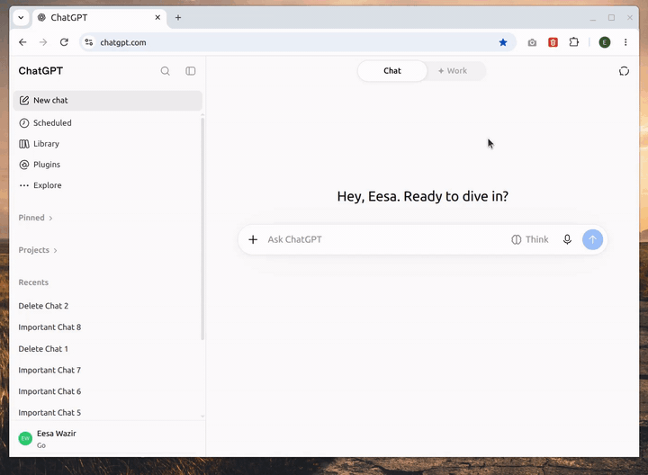

<h1 align="center">
   
  ChatPurge
</h1>

  Tick a bunch of chats in the ChatGPT sidebar. Delete them all in one go.

  
  
  

---

## ✨ What it does

Deleting ChatGPT chats one at a time is slow. ChatPurge adds checkboxes to the sidebar so you can clear out dozens in one go.

- ☑️ **Tick chats** by clicking them, or **Shift+click** to grab a whole range
- 🧹 **Select all** the chats currently loaded in the sidebar
- 🗑️ **Delete them together**, with a live progress message
- 👀 **Stays out of the way:** nothing changes on the page until you start selecting

  

<!--
📸 SCREENSHOTS: save them in docs/, then remove these comment markers.

| Selecting | Deleting |
|---|---|
|  |  |
-->

## 🚀 Install

1. Download this repository as a ZIP and extract it.
2. Open `chrome://extensions` and turn on **Developer mode** (top right).
3. Click **Load unpacked** and pick the `ChatPurge` folder.
4. Open or reload https://chatgpt.com.

## 🕹️ Use

**Quick start**

1. Press <kbd>Alt</kbd> + <kbd>Shift</kbd> + <kbd>D</kbd>, or click the ChatPurge icon in the Chrome toolbar.
2. Click the chats you want gone. Hold <kbd>Shift</kbd> and click to grab a whole range.
3. Click the  trash button in your profile row at the bottom of the sidebar, then confirm.

Press <kbd>Esc</kbd> or click  at any time to stop selecting.

**The buttons in your profile row**

-  **Select all** ticks every loaded chat. Click it again to clear.
-  **Trash** deletes the ticked chats, and shows how many there are.
-  **Done** leaves selection mode.

Progress messages appear just above the profile row.

> 💡 **Tip:** the sidebar loads older chats as you scroll. Scroll down first if you want **Select all** to reach them.

## ⚙️ How it works

It calls the same endpoint the ChatGPT website uses when you delete a chat:
`PATCH /backend-api/conversation/{id}` with `{"is_visible": false}`, authorised with the
token from `/api/auth/session`. Requests are same-origin; nothing is sent anywhere else.
Deletions are spaced 350 ms apart and retried with backoff if ChatGPT pushes back.

No build step, no dependencies, no extra permissions.

## ⚠️ Caveats

- This is an unofficial, undocumented API. OpenAI can change it or the sidebar markup at
  any time, which would break the extension.
- **Deleted chats cannot be restored.** Try it on a throwaway chat first.
- After a large batch, reload the page so ChatGPT's own sidebar cache catches up.

## 🔭 What's next

- 🔜 **claude.ai support**
